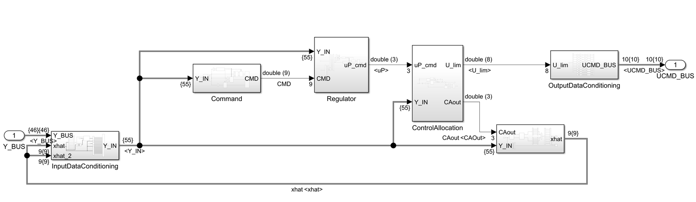
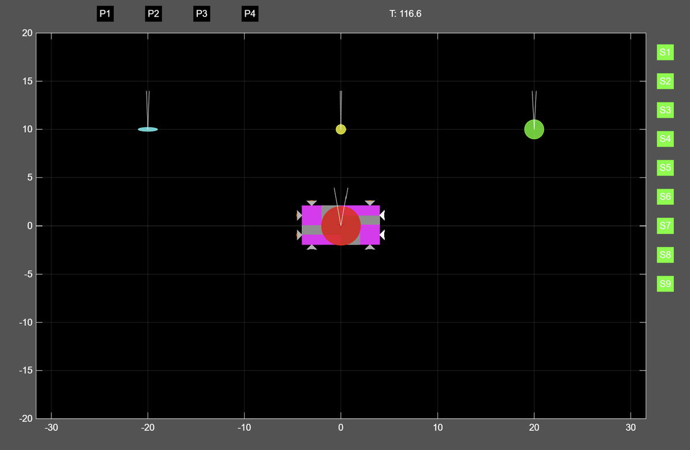

# Planar Spacecraft Guidance and Control

A MATLAB/Simulink simulation of an eight-thruster spacecraft moving in a plane. The spacecraft tracks position and heading commands and visits four communication waypoints. The model combines event-driven trajectory generation, Kalman state estimation, PD tracking, and thruster allocation in a closed loop. Mission scenarios can introduce sensor noise, fuel-dependent mass properties, and sensor or actuator failures.



## Requirements

| Dependency | Purpose |
| --- | --- |
| MATLAB R2025a and Simulink | Model authoring release and simulation runtime. The model was last saved on 64-bit Windows. |
| Control System Toolbox | Transfer-function construction and Tustin discretization in the initialization script (`tf`, `c2d`, `tfdata`). |
| Aerospace Blockset | Simulation Pace and matrix-inversion blocks referenced by the model. |
| Simulink 3D Animation | The Simulation 3D Joystick block used by the command interface. |
| Compatible joystick and desktop graphics | The joystick supplies mission commands. A MATLAB figure displays spacecraft motion and mission status. |

All project-specific MATLAB files needed by the final model are included. The MathWorks products are installed separately. The [joystick block documentation](https://www.mathworks.com/help/sl3d/simulation3djoystick.html) describes device support and axis mapping.

## Run the simulation

Set MATLAB's current folder to the extracted repository root and run:

```matlab
cd model
open_system('Bossi_Emanuele_EE460S3D_R99')
```

Connect the joystick before clicking **Run** in Simulink. The model's initialization callback loads the controller, estimator, and scenario parameters. At startup, the spacecraft is at rest at the origin. If the controls differ on your device, inspect the **Simulation 3D Joystick** block inside `ControlLaw/Command/Joystick`.

| Control | Action |
| --- | --- |
| Start | Start the mission or command a return to the origin. |
| Up | Toggle between manual and automatic modes. |
| Stick axes | Command velocities along the two translational axes and the heading axis in manual mode. |
| A, B, C, D | Select waypoints 1, 2, 3, and 4 in automatic mode. Use one destination button at a time. |

Automatic mode generates a new trajectory when a waypoint command is triggered. A destination selected outside automatic mode is stored until automatic mode is active. The fixed-step simulation uses a 1 ms plant step, a 10 ms control interval, and a configured stop time of 120 simulated seconds.



## How the model works

### Plant and mission scenario

`S3D_Plant` models translation in `x` and `y` and rotation about the out-of-plane axis. Eight thrusters produce planar forces and yaw torque. Each thruster has a nominal command range of 0–100 N. The plant models fuel consumption and can update mass and inertia during a run. The regulator, observer, and trajectory generator use fixed effective mass and inertia. With fuel burn enabled, these are the averages of the initial and dry values.

The default scenario is `LVL12`, which enables sensor noise and fuel burn and schedules no sensor or thruster failures. To run a different scenario, change `LVL=LVL12` in [`INIT_S3D_01.m`](model/INIT_S3D_01.m) to one of the level definitions in [`GetLVL_S3D_ALL.m`](model/GetLVL_S3D_ALL.m), then restart the simulation. Each level defines waypoint poses, acceptance tolerances, required dwell times, initial fuel, and noise and fault settings.

### Command generation

The manual interface turns joystick input into velocity commands. In automatic mode, a waypoint event starts a bang–coast–bang trajectory. The command subsystem uses the current pose and velocity, the target pose, and acceleration limits to compute the acceleration, coast, and braking phases. It coordinates phase timing across the axes so translation and rotation can run concurrently. Position and velocity references feed the tracking regulator.

### Measurement conditioning and estimation

With `Sconfig = 1`, each axis has a position, velocity, and acceleration measurement. The input conditioning subsystem uses reported fault flags to manage invalid readings. The discrete full-order Kalman observer estimates six states, ordered as position and velocity pairs for `x`, `y`, and heading. It predicts state using a double-integrator model per axis and corrects the prediction using the measurement residual. The output model includes direct feedthrough from applied force or torque to acceleration. The initialization script sets the measurement covariance from the squared sensor standard deviations in the scenario.

### Tracking and thruster allocation

For each axis, the PD regulator multiplies position error by `Kp` and velocity error by `Kd` and sums the two terms. Matching the nominal error dynamics to a second-order model gives `Kp = M_eff × ωn²` and `Kd = 2 × ζ × ωn × M_eff` for translation. The heading loop uses the effective yaw inertia in place of mass. In R99, nominal and fault-mode gain parameters have the same values.

The control allocator rotates the requested force into the body frame and maps the force and torque request to individual thruster commands. It uses the thruster geometry and failure information in the allocation path. Thruster bounds and actuator loss limit the force and torque the plant can deliver, so simultaneous axis commands can compete for the available actuation.

## Inspect a run

Use the spacecraft animation to check waypoint arrival and communication completion. To diagnose tracking, inspect the position and velocity references alongside the estimated states, then check the commanded thruster forces for saturation. The model's stop callback reports simulated and wall-clock time and computes a mission score from elapsed time, fuel use, and waypoint completion. Manual input timing affects run-to-run comparisons.

See the [design report](docs/design-report.pdf) for design trade-offs, command timing, and the illustrated joystick guide.

## Repository layout

| File | Role |
| --- | --- |
| [`Bossi_Emanuele_EE460S3D_R99.slx`](model/Bossi_Emanuele_EE460S3D_R99.slx) | Final model with the plant, controller, mission logic, and visualization hooks. |
| [`Bossi_Emanuele_EE460_Final.m`](model/Bossi_Emanuele_EE460_Final.m) | Initializes controller and observer parameters, allocation geometry, filters, and command limits. |
| [`INIT_S3D_01.m`](model/INIT_S3D_01.m) | Selects the scenario and initializes plant, sensor, and simulation parameters. |
| [`GetLVL_S3D_ALL.m`](model/GetLVL_S3D_ALL.m) | Defines mission scenarios. |
| [`PlotS3D.m`](model/PlotS3D.m) and [`blkwhitebg.m`](model/blkwhitebg.m) | Render the spacecraft animation and manage its color scheme. |

## Credits

Control system design and integration by Emanuele Bossi for EE 460 at Embry-Riddle Aeronautical University, Spring 2026. The simulation builds on the course-provided S3D plant and MATLAB utilities.
